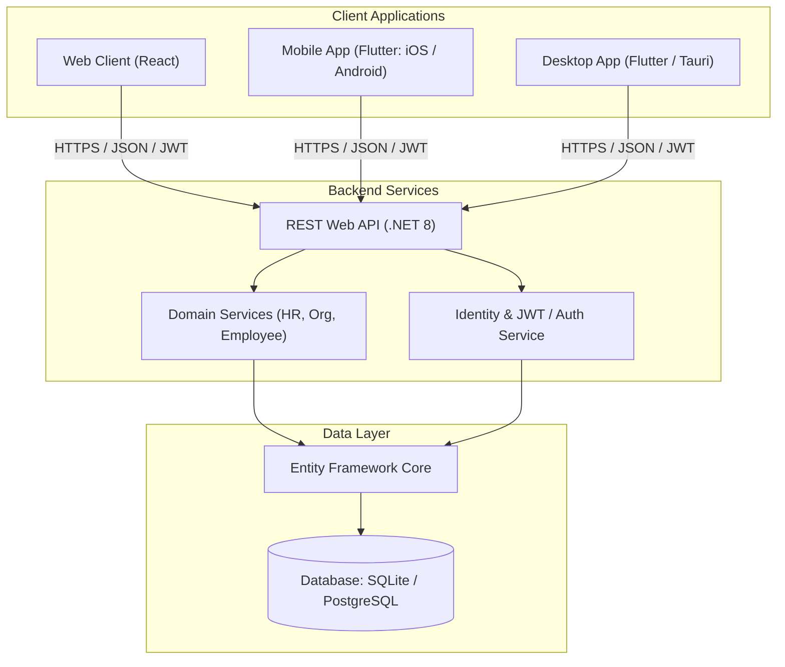

# CrystalSpace System Architecture

## 1. High-Level Topology



---

## 2. Monorepo Organization

```
CrystalSpace/
├── Frontend/
│   ├── web/               # React web application (Vite / Next.js)
│   ├── mobile/            # Flutter mobile application (iOS & Android)
│   └── desktop/           # Desktop application (Flutter Desktop or Tauri)
│
├── Backend/               # Backend API & Business Domain
│   ├── Organize4u.sln     # Visual Studio / .NET Solution
│   ├── Organize4u.Api/    # REST API endpoints, Auth, Swagger/OpenAPI
│   ├── Organize4u.Core/   # Domain Entities, DTOs, Enums, Interfaces
│   ├── Organize4u.Data/   # EF Core DbContext, Repositories, Migrations
│   └── Organize4u.Service/# Business Logic Services
│
└── CrystalDocuments/      # Architecture, Tracking, Roadmap, & Specs
    ├── ARCHITECTURE.md    # System topology, API contracts, security
    ├── ADR-001-STACK-EVALUATION.md # Architecture decision records
    └── TRACKING.md        # Feature tracking, progress & task status
```

---

## 3. Communication Contract & Protocols
- **API Protocol**: RESTful JSON over HTTPS.
- **Specification**: OpenAPI (Swagger) v3.0 standard.
- **Client Generation**: Auto-generate TypeScript client for React Web and Dart models for Flutter Mobile from OpenAPI specs to eliminate drift.
- **Authentication**: JWT Bearer Tokens with Refresh Tokens, or Secure HttpOnly Cookies for Web + Token Auth for Mobile/Desktop.
- **Authorization**: Role-Based Access Control (RBAC) & Claims using ASP.NET Core Identity.
