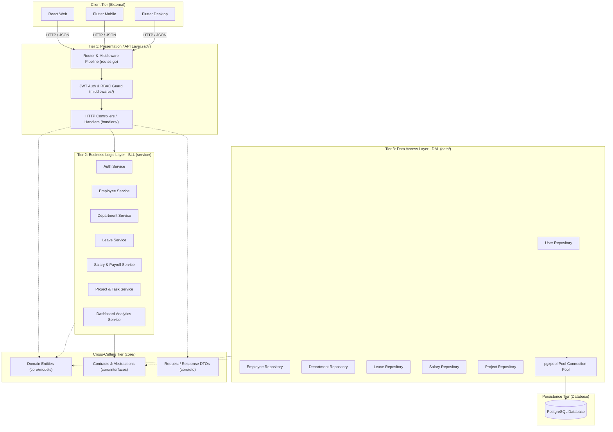

# CrystalSpace Backend: N-Tier Architecture Specification

## 1. Architectural Overview

The backend strictly follows the **N-Tier Architecture Pattern** (Presentation, Business Logic, Data Access, and Core Abstractions) with explicit separation of concerns and Inversion of Control (IoC):



---

## 2. Directory Layout & Tier Responsibilities

```
Backend/
├── cmd/
│   ├── api/
│   │   └── main.go                  # Server Bootstrapper & Dependency Injection
│   └── seed/
│       └── main.go                  # Database Seeder (Roles, Admin, Depts, Leave Types)
│
├── api/                             # [TIER 1: PRESENTATION LAYER]
│   ├── handlers/                    # RESTful HTTP Handlers (Controllers)
│   │   ├── auth_handler.go
│   │   ├── employee_handler.go
│   │   ├── department_handler.go
│   │   ├── leave_handler.go
│   │   ├── salary_handler.go
│   │   ├── project_handler.go
│   │   └── dashboard_handler.go
│   ├── middlewares/                 # HTTP Interceptors
│   │   ├── auth.go                  # JWT Token Parser & RBAC Enforcer
│   │   └── cors.go                  # CORS for React Web & Flutter
│   └── routes.go                    # Chi Router definitions & route groupings
│
├── service/                         # [TIER 2: BUSINESS LOGIC LAYER (BLL)]
│   ├── auth_service.go              # Password hashing, JWT token generation
│   ├── employee_service.go          # Employee creation, profile updates, directory
│   ├── department_service.go        # Department validations
│   ├── leave_service.go             # Date checks, leave balance deduction
│   ├── salary_service.go            # Payroll math, HRA/PF calculations, revision audit
│   ├── project_service.go           # Task workflows & transitions
│   └── dashboard_service.go         # Cross-domain aggregation metrics
│
├── data/                            # [TIER 3: DATA ACCESS LAYER (DAL)]
│   ├── postgres/
│   │   ├── db.go                    # pgxpool.Pool connection lifecycle
│   │   ├── migrator.go              # Embedded SQL Auto-migration runner
│   │   └── schema.sql               # Embedded DDL Schema
│   ├── user_repo.go                 # User SQL queries
│   ├── employee_repo.go             # Employee queries & 1-to-1 detail joins
│   ├── department_repo.go           # Department SQL queries
│   ├── leave_repo.go                # Leave SQL queries & dynamic balance calculation
│   ├── salary_repo.go               # Salary upsert & history logs
│   └── project_repo.go              # Project and task SQL queries
│
├── core/                            # [CROSS-CUTTING / CORE DOMAIN & CONTRACTS]
│   ├── models/                      # Pure domain models (zero external dependencies)
│   │   ├── user.go
│   │   ├── employee.go
│   │   ├── department.go
│   │   ├── leave.go
│   │   ├── salary.go
│   │   ├── project.go
│   │   └── document.go
│   ├── interfaces/                  # Interface abstractions for Repositories & Services
│   │   ├── repositories.go
│   │   └── services.go
│   └── dto/                         # Request and Response Data Transfer Objects
│       └── dtos.go
│
├── config/                          # Environment Configuration
│   └── config.go                    # PORT, DATABASE_URL, JWT_SECRET, ENV
├── pkg/                             # Reusable Helpers
│   ├── response/
│   │   └── response.go              # Standardized JSON response envelope
│   └── security/
│       ├── security.go              # Bcrypt hasher & JWT generator
│       └── security_test.go         # Unit tests
├── migrations/
│   └── 000001_initial_schema.up.sql # Raw PostgreSQL migration script
├── bin/                             # Compiled Binaries
│   ├── api.exe                      # Standalone Web API Server (17.9 MB)
│   └── seed.exe                     # Standalone Database Seeder (15.0 MB)
├── .env.example
├── go.mod
└── go.sum
```

---

## 3. Strict Layering Rules Followed
1. **No Circular Dependencies**: `core/models` and `core/interfaces` do not import any other internal packages.
2. **IoC (Inversion of Control)**: The Service Layer depends on `core/interfaces.Repository`, never concrete `data/` structs.
3. **Data Protection**: Handlers only receive DTOs and return standardized JSON responses. Password hashes are excluded (`json:"-"`).
4. **Resilience**: Embedded schema auto-migrates PostgreSQL on server startup if tables do not exist.
